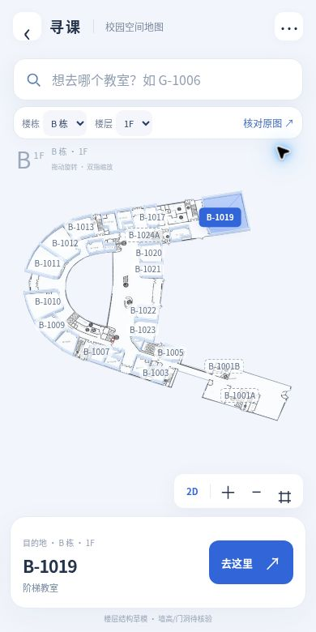

# 寻课 · 西浦太仓校园地图

面向西交利物浦大学太仓校区同学的校园找教室网站。通过楼层三维结构、教室编号搜索和原始展示牌，帮助同学了解教室所在位置。

[在线体验](https://taicang-campus-wayfinder-demo.lmx20061229.chatgpt.site)

学生共建项目，非学校官网。当前优先建立校园空间地图。

## 当前进度

- B 栋：1F–5F。
- F、G 栋：BF–5F。
- 共 17 张楼层地图，支持楼栋/楼层切换、教室搜索、三维与俯视展示、原图核对。
- 现阶段导航为起终点位置预览，尚未提供自动定位、转弯指引或实际距离估算。

## 预览



## 数据准确性

模型依据收集到的楼层展示牌照片描摹。照片透视尚未测绘校正；墙高、墙厚仅作示意，部分门洞和小隔间待复核。虚线编号表示已定位但未独立建立房间边界。未读清的编号不按连续序号补造。

AB、BC、EF、FG、GA 等连廊前缀按原图保留。B 栋三层展示牌上的 AB-2002 存在楼层编号疑点，已保留原编号并标注待核对。

本项目不能作为已核验的通行或应急疏散指引。

## 本地运行

无需 API Key 或付费地图服务。使用 Python 启动静态服务器：

```sh
python -m http.server 8000 --directory dist
```

打开 http://localhost:8000 。请使用 HTTP 服务器，直接双击 HTML 可能无法加载模块和 JSON。

使用 Node.js 检查楼层数据：

```sh
node scripts/check-floor-data.mjs
```

## 目录

- `dist/`：可部署的静态网站，HTML、CSS、JavaScript、Three.js 与地图资源。
- `dist/indoor/`：各楼栋楼层的结构化数据。
- `dist/b-assets/`、`dist/f-assets/`、`dist/g-assets/`：原图和楼层图资源。
- `docs/`：版本说明和预览。
- `scripts/`：数据准备及检查脚本。

## 参与共建

欢迎通过 Issues 提交清晰的楼层展示牌、门牌核对结果、楼梯/电梯/连廊位置更正。请注明楼栋、楼层和拍摄日期，并避免上传人物或私人信息。

下一阶段优先完善其余楼栋与整体校园结构，再验证跨层、跨栋通行关系。

## 资源说明

校园图纸、照片及第三方依赖的权利归原权利人所有。本仓库暂未为这些素材授予额外的再分发许可；第三方依赖遵循随附许可。
